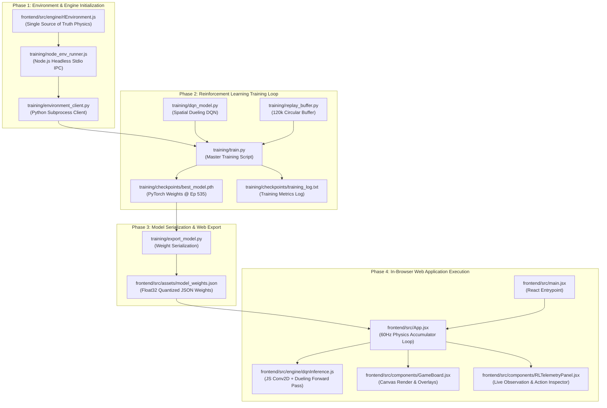

# Complete Project Architecture & End-to-End Workflow Guide

> **Project**: Deep Reinforcement Learning Breakout / Catch Game  
> **Stack**: PyTorch (CUDA GPU) • Node.js IPC • React 19 • Vite • HTML5 Canvas • Vanilla CSS  
> **Author**: Antigravity AI Pair Programming System  

---

## 1. Executive Project Overview

This repository implements a **full-stack Reinforcement Learning (RL) arcade game (Breakout)** featuring an end-to-end training and deployment pipeline:
1. **True 1:1 Physics Parity**: The environment is written in JavaScript (`frontend/src/engine/rlEnvironment.js`). The Python training engine does not simulate a second, slightly different physics engine; instead, it runs the **exact same JavaScript environment** headless inside Node.js via high-speed line-buffered IPC subprocesses.
2. **Compact Spatial Grid CNN (Spatial-Dueling-DQN)**: The state observation is a 134-dimensional continuous vector that is dynamically reshaped into a **3-channel 16×16 spatial tensor** (Bricks channel, Paddle channel, Ball channel) and a **6-dimensional kinematic continuous vector**.
3. **Zero-Dependency Browser Inference**: Once trained in PyTorch, neural network weights are serialized into a lightweight JSON file (`model_weights.json`). The React frontend executes real-time 2D convolutions (`conv2d`), max pooling (`maxpool2d`), and dense forward passes entirely in **pure JavaScript (Float32Array)** at 60 FPS without requiring Python, WebAssembly, or external inference servers.

---

## 2. Complete Project Directory Structure

```
rl-catch-game/
├── README.md                           # Quickstart guide & project summary
├── requirements.txt                    # Python runtime dependencies (torch, numpy)
├── PROJECT_WORKFLOW.md                 # Master architecture, file guide & workflow documentation (This file)
│
├── agents/                             # Dedicated Self-Contained Agent Workspaces
│   ├── agent1_vector_dqn/              # Agent 1: 134-Dim Vector Dueling MLP
│   │   ├── model.py                    # Dueling Vector MLP architecture
│   │   ├── train.py                    # Vector DQN training script
│   │   ├── export.py                   # Web JSON exporter
│   │   ├── checkpoints/best_model.pth  # Checkpoint from 134D vector run
│   │   └── logs/                       # Training logs
│   │
│   ├── agent2_cnn_dqn/                 # Agent 2: Compact Spatial Grid CNN (88/88 Winner)
│   │   ├── model.py                    # Spatial Dueling CNN (3x16x16 Conv2D + Kinematics)
│   │   ├── train.py                    # CNN training script
│   │   ├── export.py                   # Web JSON exporter
│   │   ├── analyze_log.py              # CNN log parser & performance metrics
│   │   ├── compare_models.py           # Checkpoint inspection script (weights & norms diffs)
│   │   ├── checkpoints/best_model.pth  # Peak checkpoint (Ep 535 / 1698 avg)
│   │   └── logs/training_log.txt       # Complete 1,500-episode training log
│   │
│   └── agent3_rainbow_dqn/             # Agent 3: Distributional Rainbow DQN (C51 + PER)
│       ├── model.py                    # RainbowDuelingC51Network (Spatial CNN + Kinematics + NoisyNet)
│       ├── train.py                    # Multi-step distributional Rainbow loop with PER & soft resets
│       ├── export.py                   # C51 atom distribution web JSON exporter
│       ├── prioritized_replay.py       # Binary SumTree & MinTree Prioritized Experience Replay buffer
│       ├── checkpoints/                # Model checkpoints (model_weights_rainbow.json)
│       └── logs/                       # Training logs (training_log.txt - 850 episodes)
│
├── training/                           # Shared Environment Bridge & Evaluation Utilities
│   ├── node_env_runner.js              # Headless Node.js subprocess exposing rlEnvironment.js over stdio IPC
│   ├── environment_client.py           # Gymnasium-like Python client communicating with node_env_runner.js
│   ├── replay_buffer.py                # Pre-allocated circular NumPy experience replay buffer (120k capacity)
│   ├── evaluate.py                     # Universal evaluation benchmark tool for all 3 agents
│   ├── export_model.py                 # Universal weight export utility to browser JSON
│   └── checkpoints/                    # Historical checkpoint archive
│
└── frontend/                           # React 19 + Vite Interactive Web Application
    ├── package.json                    # Frontend package dependencies & scripts (React 19, Lucide, Canvas Confetti)
    ├── vite.config.js                  # Vite bundler configuration
    ├── index.html                      # HTML5 entrypoint mounting root DOM
    │
    └── src/
        ├── main.jsx                    # React application entry point (ReactDOM.createRoot)
        ├── App.jsx                     # Master application component, simulation loop, mode switches & HUD
        ├── index.css                   # Global CSS design system (cyberpunk dark mode, neon glow, glassmorphism)
        ├── App.css                     # Component layout and canvas styling
        │
        ├── assets/
        │   └── model_weights.json      # Deployed trained neural network weights for in-browser inference
        │
        ├── engine/                     # Game Engine, Physics, Audio & RL Logic
        │   ├── rlEnvironment.js        # Single Source of Truth physics engine (Minkowski collision, rewards)
        │   ├── dqnInference.js         # Pure JavaScript convolutional & dense neural network inference engine
        │   ├── levels.js               # Level brick layout generators (Space Invader, Castle, Pyramid, Wall)
        │   ├── audio.js                # Web Audio API procedural synthesizer (bounces, breaks, game over sounds)
        │   ├── particles.js            # Visual particle FX and screen shake simulation
        │   └── trainingBridge.js       # Optional WebSocket bridge for live browser training
        │
        └── components/                 # React Modular UI Components
            ├── GameBoard.jsx           # HTML5 Canvas renderer, trajectory prediction, and overlay dialogs
            ├── Header.jsx              # Top bar HUD displaying Score, High Score, Combo, FPS & AI badges
            ├── RLTelemetryPanel.jsx    # Real-time RL inspector (continuous observation meters, action monitor)
            ├── RewardChart.jsx         # Live rolling episode reward SVG graph
            ├── RewardConfigModal.jsx   # Interactive modal to inspect and tune reward weights
            └── RulesModal.jsx          # Interactive game manual and RL system architecture explanation
```

---

## 3. Comprehensive File-by-File Analysis

Every file in the codebase has a distinct responsibility. Below is the breakdown detailing what each file does, its exact inputs, internal logic, and outputs.

---

### A. Python Training Pipeline (`training/`)

#### 1. `training/node_env_runner.js`
- **Role**: Headless execution worker for the JavaScript simulation.
- **Inputs**: JSON command strings piped to `process.stdin` (commands: `"reset"`, `"step"`, `"close"`).
- **Internal Logic**:
  - Instantiates `const env = new BreakoutEnv({ trainingMode: true })`.
  - On `cmd === "reset"`: Resets the game state, returns initial observation and brick metadata.
  - On `cmd === "step"`: Applies the chosen action across `frame_skip` consecutive 60Hz sub-frames, accumulates rewards, and detects termination flags.
- **Outputs**: Writes formatted JSON response strings directly to `process.stdout` (`{ obs, reward, terminated, truncated, info }`).

#### 2. `training/environment_client.py`
- **Role**: Python client wrapper conforming to the standard OpenAI Gym / Gymnasium API.
- **Inputs**: Action integers (`0: LEFT`, `1: STAY`, `2: RIGHT`), `frame_skip`, `max_steps`.
- **Internal Logic**:
  - Spawns `node training/node_env_runner.js` as an OS subprocess with bidirectional line-buffered pipes.
  - Serializes Python calls into JSON strings, sends them over `stdin`, and blocks until reading the corresponding `stdout` JSON line.
  - Converts stringified JSON observation arrays into `np.ndarray` of dtype `np.float32` and shape `(134,)`.
- **Outputs**:
  - `reset(max_steps) -> (obs, info)`
  - `step(action) -> (obs, reward, terminated, truncated, info)`

#### 3. `training/replay_buffer.py`
- **Role**: High-speed memory storage for reinforcement learning experience replay.
- **Inputs**: Transition tuples `(state, action, reward, next_state, done)`.
- **Internal Logic**:
  - Pre-allocates fixed-size contiguous C-order NumPy arrays for states `(120000, 134)`, actions `(120000,)`, rewards `(120000,)`, next states `(120000, 134)`, and dones `(120000,)`.
  - Implements a circular ring buffer with a rolling pointer `ptr = (ptr + 1) % capacity`.
  - Random mini-batch sampling generates batched PyTorch tensors directly on the target compute device (`cuda` or `cpu`).
- **Outputs**: `sample(batch_size, device)` returning 5 PyTorch tensors `(b_states, b_actions, b_rewards, b_next_states, b_dones)`.

#### 4. `training/dqn_model.py`
- **Role**: Defines the neural network architectures and the reinforcement learning agent.
- **Architectures**:
  1. `state_to_spatial_grid(x)`: Dynamic CUDA tensor vectorization:
     - Channel 0 (16×16): Intact brick indicators extracted from elements 6–133.
     - Channel 1 (16×16): Paddle position placed along Row 14 with continuous coordinate clamping.
     - Channel 2 (16×16): Ball position projected from continuous `(x, y)` into 16×16 grid space.
  2. `SpatialDuelingDQN`:
     - **Spatial Stream**: `Conv2d(3, 32)` → `ReLU` → `MaxPool2d` → `Conv2d(32, 64)` → `ReLU` → `MaxPool2d` → `Conv2d(64, 64)` → `Flatten` → `Linear(1024, 128)`.
     - **Kinematic Stream**: `Linear(6, 64)` → `ReLU` → `Linear(64, 64)` → `ReLU`.
     - **Fusion**: Concatenates spatial (128) and kinematic (64) features into a 192-dim vector.
     - **Dueling Streams**: Independent `value_stream` (192 → 64 → 1) and `advantage_stream` (192 → 64 → 3).
     - **Q-Value Reconstruction**: $Q(s, a) = V(s) + \left(A(s, a) - \frac{1}{|A|}\sum_{a'} A(s, a')\right)$.
  3. `VectorDQNAgent`:
     - Manages `policy_net`, `target_net`, Adam optimizer, epsilon-greedy action selection, target network synchronization, and disk save/load.
- **Inputs**: Observation tensor of shape `(Batch, 134)`.
- **Outputs**: Predicted Q-values for actions `[LEFT, STAY, RIGHT]` of shape `(Batch, 3)`.

#### 5. `training/train.py`
- **Role**: The master orchestration script that trains the Deep Q-Network.
- **Inputs**: Command-line arguments (`--episodes`, `--batch-size`, `--lr`, `--epsilon-decay-steps`, `--buffer-size`, `--model-type`, `--device`).
- **Internal Logic**:
  - Initializes `BreakoutClientEnv`, `ReplayBuffer`, and `VectorDQNAgent`.
  - Runs the double-DQN training loop over 1,500 episodes:
    1. Collects transitions with epsilon-greedy exploration.
    2. Performs gradient descent using **Smooth L1 (Huber) loss** against Double-DQN targets:
       $$y_t = r_t + \gamma \cdot Q_{\text{target}}\left(s_{t+1}, \operatorname{argmax}_{a} Q_{\text{policy}}(s_{t+1}, a)\right)$$
    3. Periodically syncs `target_net` every 1,000 steps.
    4. Tracks 30-episode moving averages of rewards, step counts, and bricks broken.
    5. Saves `best_model.pth` whenever a new peak rolling average is reached.
- **Outputs**:
  - Console telemetry at every episode.
  - Comprehensive log file: `training/checkpoints/training_log.txt`.
  - Checkpoint files: `best_model.pth`, `final_model.pth`, and periodic checkpoints.

#### 6. `training/export_model.py`
- **Role**: Bridges Python PyTorch weights into JavaScript.
- **Inputs**: PyTorch `.pth` checkpoint path, output path (defaults to `frontend/src/assets/model_weights.json`).
- **Internal Logic**:
  - Loads PyTorch state dictionary on CPU.
  - Extracts weights and biases from convolutional, kinematic, value, and advantage layers.
  - Converts PyTorch tensors to NumPy arrays and rounds them to 6 decimal places.
  - Packages network metadata (`episode`, `peak_avg_reward`, `architecture`, `format`) and layer tensors into a single structured JSON object.
- **Outputs**: Browser-compatible JSON file: `frontend/src/assets/model_weights.json`.

#### 7. `training/evaluate.py`
- **Role**: Independent evaluation benchmark running purely greedy inference.
- **Inputs**: `--checkpoint`, `--episodes` (e.g. 50), `--device`.
- **Internal Logic**: Runs games with exploration disabled ($\epsilon \le 0.01$), tracking total bricks cleared, stage clear win rates, survival steps, and reward statistics.
- **Outputs**: Terminal report and `training/checkpoints/evaluation_report.txt`.

#### 8. `training/compare_models.py`
- **Role**: Model inspection and diagnostic utility.
- **Inputs**: Reads `training/checkpoints/best_model.pth` and `final_model.pth`.
- **Internal Logic**: Compares layer weight norms ($\ell_2$), parameter drift, and training metadata to diagnose catastrophic forgetting or policy drift.
- **Outputs**: Terminal table showing parameter differences across layers.

#### 9. `training/analyze_log.py`
- **Role**: Post-training data analytics parser.
- **Inputs**: Reads `training/checkpoints/training_log.txt`.
- **Internal Logic**: Aggregates episodes into 100-episode bins, identifies peak reward windows, finds games with $\ge 45$ bricks cleared, and locates stage-clear wins.
- **Outputs**: Formatted performance progression tables printed to console.

---

### B. Game Engine & In-Browser Inference (`frontend/src/engine/`)

#### 10. `frontend/src/engine/rlEnvironment.js`
- **Role**: The canonical physics, collision, and reward engine used across the entire project.
- **State Vector Specification (134 Dimensions)**:
  - `[0]`: Paddle Center X normalized to $[-1, 1]$.
  - `[1]`: Ball X normalized to $[-1, 1]$.
  - `[2]`: Ball Y normalized to $[-1, 1]$.
  - `[3]`: Ball Velocity X normalized $[-1, 1]$.
  - `[4]`: Ball Velocity Y normalized $[-1, 1]$.
  - `[5]`: Ratio of remaining breakable bricks to total breakable bricks $[0, 1]$.
  - `[6 ... 133]`: Flattened 8×16 grid of brick states ($1.0$ = intact, $0.5$ = damaged, $-1.0$ = unbreakable, $0.0$ = destroyed).
- **Physics Core**:
  - Continuous Collision Detection (CCD) using 4 micro-substeps per frame.
  - Exact Minkowski Sum Circle-vs-AABB reflection with normal determination.
  - Ball speed escalation: Base velocity starts at $4.2$, accelerating up to $6.8$ as bricks are destroyed.
- **Reward Function**:
  - Ball Catch on Paddle: `+12.0`
  - Brick Destruction: `+20.0`
  - Milestones: 25% cleared (`+25.0`), 50% cleared (`+50.0`), 75% cleared (`+100.0`)
  - Stage Clear: `+500.0`
  - Proximity Potential Shaping: Up to `+0.06` per step for aligning paddle beneath ball.
  - Ball Drop Penalty: `-12.0` (triggers `lifeLostTerminated = true`).
- **Outputs**: `{ obs: { vector, brickLayout }, reward, terminated, truncated, breakdown }`.

#### 11. `frontend/src/engine/dqnInference.js`
- **Role**: Zero-dependency, client-side neural network execution engine.
- **Inputs**: 134-dimensional observation vector `stateVector`.
- **Internal Operations**:
  1. `state_to_spatial_grid`: Populates 3-channel 16×16 Float32Array representing bricks, paddle, and ball.
  2. `conv2d(input, inC, H, W, weight, bias, outC, kernelSize=3, padding=1)`: Executes 2D discrete spatial convolutions with fused ReLU activation.
  3. `maxpool2d(input, C, H, W)`: Downsamples feature maps by a factor of 2.
  4. `linear(x, weight, bias, activation)`: Performs matrix-vector multiplication with ReLU or linear pass.
  5. Computes state value $V(s)$ and advantage vector $A(s, :)$.
  6. Reconstructs Q-values: $Q(s, a) = V(s) + (A(s, a) - \text{mean}(A(s)))$.
- **Outputs**: `{ action: 0 | 1 | 2, qValues: [qLeft, qStay, qRight], isTrained: true }`.

#### 12. `frontend/src/engine/levels.js`
- **Role**: Brick layout definitions and procedural level generators.
- **Contents**: Defines brick types (`NORMAL`, `REINFORCED`, `UNBREAKABLE`), point values, color palettes, and layouts (`invader`, `castle`, `pyramid`, `classic`).
- **Outputs**: Grid array `(8 rows × 16 cols)` of brick objects.

#### 13. `frontend/src/engine/particles.js`
- **Role**: Real-time particle visual effects and screen shake system.
- **Outputs**: Particle animation updates and screen shake offsets `(shakeX, shakeY)`.

#### 14. `frontend/src/engine/audio.js`
- **Role**: Sound synthesizer built on the HTML5 Web Audio API.
- **Outputs**: Procedural audio frequencies for paddle bounces, brick explosions, victory chimes, and game over sounds.

#### 15. `frontend/src/engine/trainingBridge.js`
- **Role**: WebSocket client for streaming live browser frames and actions to an external Python socket server.
- **Outputs**: Bidirectional JSON communication over `ws://localhost:8765`.

---

### C. React UI Layer (`frontend/src/` & `components/`)

#### 16. `frontend/src/main.jsx`
- **Role**: React application bootstrapper.
- **Outputs**: Mounts the `<App />` component inside `#root` in `index.html`.

#### 17. `frontend/src/App.jsx`
- **Role**: Master state container and fixed-timestep simulation runner.
- **Inputs**: User input events (Keyboard, Mode switch, File upload).
- **Internal Logic**:
  - Initializes `BreakoutEnv` with fixed $\Delta t = 1/60$s and `maxSteps: Infinity`.
  - Imports default weights from `assets/model_weights.json` on mount.
  - Maintains the requestAnimationFrame game loop with a **fixed 60Hz physics accumulator** identical to the training timestep.
  - Queries `dqnInference.predict(obs.vector)` when `playerMode === 'ai'`.
- **Outputs**: Renders game layout, distributes telemetry props, and controls game overlays.

#### 18. `frontend/src/components/GameBoard.jsx`
- **Role**: HTML5 Canvas rendering component.
- **Rendering Layers**:
  1. Cyberpunk arcade grid background.
  2. Brick grid with neon bevels and damage states.
  3. Particle explosion effects and ball trail glow.
  4. Ball trajectory predictor raycast.
  5. Player paddle with thruster particles.
  6. Victory / Ball Missed modal dialogs.
- **Outputs**: 60 FPS visual display on HTML5 Canvas.

#### 19. `frontend/src/components/Header.jsx`
- **Role**: Top HUD showing current score, high score, combo multiplier, FPS counter, mute toggle, and AI mode badge.

#### 20. `frontend/src/components/RLTelemetryPanel.jsx`
- **Role**: Real-time RL inspection dashboard.
- **Visualizes**:
  - Normalized continuous observations (`paddle_x`, `ball_x`, `ball_y`, `ball_vx`, `ball_vy`).
  - Active spatial brick tensor heatmap (8×16 grid).
  - Selected action indicator (`LEFT`, `STAY`, `RIGHT`).
  - Live reward breakdown stream showing exactly why rewards were granted.

#### 21. `frontend/src/components/RewardChart.jsx`
- **Role**: Dynamic SVG graph charting cumulative episode reward over recent simulation steps.

#### 22. `frontend/src/components/RewardConfigModal.jsx` & `RulesModal.jsx`
- **Role**: Modal dialogs explaining game rules, reward math, and deep RL architecture details.

---

## 4. End-to-End Execution Lifecycle (Which File Runs First, Next, and Output)



### Detailed Chronological Step Breakdown:

1. **Step 1: Python Launches Environment Client**
   - **Running File**: `training/train.py` calls `BreakoutClientEnv()` in `training/environment_client.py`.
   - **Action**: `environment_client.py` spawns `node training/node_env_runner.js` as a background process.
   - **Output**: Open standard input/output IPC channel communicating at thousands of frames per second.

2. **Step 2: Environment Reset & Observation Delivery**
   - **Running File**: `node_env_runner.js` invokes `env.reset()` in `frontend/src/engine/rlEnvironment.js`.
   - **Output**: Returns the initial 134-dimensional observation vector $s_0$ to Python.

3. **Step 3: Action Selection & Physics Stepping**
   - **Running File**: `training/train.py` requests an action $a_t$ from `VectorDQNAgent` in `training/dqn_model.py` (using $\epsilon$-greedy strategy).
   - **Action**: Action is passed via IPC to `node_env_runner.js`, which steps `rlEnvironment.js` forward by 4 sub-frames (action repeat = 4).
   - **Output**: Next state $s_{t+1}$, reward $r_t$, and termination flags (`terminated`, `truncated`).

4. **Step 4: Replay Storage & Double-DQN Optimization**
   - **Running File**: `training/train.py` pushes transition $(s_t, a_t, r_t, s_{t+1}, d_t)$ into `training/replay_buffer.py`.
   - **Action**: Once warmup steps exceed 1,000, PyTorch samples a 64-sample batch, applies Double-DQN target math, and performs Adam backpropagation with gradient clipping.
   - **Output**: Network weight updates on CUDA GPU.

5. **Step 5: Checkpointing & Log Generation**
   - **Running File**: `training/train.py`.
   - **Action**: Evaluates rolling 30-episode average reward. When a new high score is reached, it saves the agent state dictionary.
   - **Output**: Saves `training/checkpoints/best_model.pth` and records episode metrics in `training/checkpoints/training_log.txt`.

6. **Step 6: Model Export to Browser Format**
   - **Running File**: `training/export_model.py`.
   - **Command**:
     ```bash
     D:\Fast_gpu\Scripts\python.exe training/export_model.py --checkpoint training/checkpoints/best_model.pth --output frontend/src/assets/model_weights.json
     ```
   - **Action**: Reads `best_model.pth`, converts convolutional and linear weight tensors into JavaScript-accessible arrays, and packages metadata.
   - **Output**: Generates `frontend/src/assets/model_weights.json` (~4.7 MB).

7. **Step 7: Web Application Initialization**
   - **Running File**: `frontend/src/main.jsx` mounts `<App />` inside `index.html`.
   - **Action**: `App.jsx` imports `model_weights.json` and loads it into `DQNInference` in `frontend/src/engine/dqnInference.js`.
   - **Output**: The green badge *"Trained AI Model Active (Episode 535, Peak Avg 1698.07)"* appears in the UI.

8. **Step 8: Real-Time In-Browser Inference Loop**
   - **Running File**: `frontend/src/App.jsx`.
   - **Action**: At every 60Hz tick, if `playerMode === 'ai'`, `App.jsx` passes `env.getObservation().vector` to `dqnInference.predict()`.
   - **Output**: `dqnInference.js` performs client-side Conv2D + Dueling forward pass in under 0.8ms, choosing `LEFT`, `STAY`, or `RIGHT`.
   - **Visuals**: `GameBoard.jsx` draws the paddle, ball, and bricks; `RLTelemetryPanel.jsx` updates Q-values and continuous feature meters.

---

## 5. Comprehensive File Dependency & Output Matrix

| File Path | Role | Executed By | Primary Input | Primary Output |
| :--- | :--- | :--- | :--- | :--- |
| **`frontend/src/engine/rlEnvironment.js`** | Canonical Breakout Engine | Node.js / Browser | Actions (`0, 1, 2`), $\Delta t$ | `{ obs, reward, terminated, info }` |
| **`training/node_env_runner.js`** | Headless Node IPC Runner | `environment_client.py` | JSON commands on `stdin` | JSON results on `stdout` |
| **`training/environment_client.py`** | Gym-style Python Interface | `train.py` / `evaluate.py` | Python integers / parameters | NumPy array `obs(134,)`, float reward |
| **`training/replay_buffer.py`** | Experience Replay Buffer | `train.py` | Step transitions | Batched PyTorch tensors on CUDA |
| **`training/dqn_model.py`** | Spatial-Dueling-DQN Model | `train.py` / `evaluate.py` | Batched observations `(B, 134)` | Q-values `(B, 3)`, agent weights |
| **`training/train.py`** | Master Training Script | User (CLI) | Hyperparameters & Environment | `best_model.pth`, `training_log.txt` |
| **`training/export_model.py`** | Model Weight Serializer | User (CLI) | Checkpoint `.pth` file | `frontend/src/assets/model_weights.json` |
| **`training/evaluate.py`** | Benchmark Evaluator | User (CLI) | Checkpoint `.pth` file | Win-rate & evaluation report |
| **`training/compare_models.py`** | Weight Drift Inspector | User (CLI) | Two `.pth` checkpoints | Weight norm diff table |
| **`training/analyze_log.py`** | Log Data Parser | User (CLI) | `training_log.txt` | Metric progression summaries |
| **`frontend/src/engine/dqnInference.js`** | Pure JS Neural Engine | `App.jsx` | `model_weights.json`, state vector | Predicted action & Q-values |
| **`frontend/src/engine/levels.js`** | Level Presets | `rlEnvironment.js` | Level name string | 8×16 brick array |
| **`frontend/src/engine/audio.js`** | Procedural Audio | `rlEnvironment.js` / React | Sound trigger calls | Sound waves via Web Audio API |
| **`frontend/src/engine/particles.js`** | Particle FX System | `rlEnvironment.js` / Canvas | Collision events | Particle array & screen shake |
| **`frontend/src/main.jsx`** | React Root | Browser / Vite | `index.html` | Mounted React DOM tree |
| **`frontend/src/App.jsx`** | Simulation & State Host | React | User events, model weights | Main game UI & HUD layout |
| **`frontend/src/components/GameBoard.jsx`** | Canvas Renderer | `App.jsx` | Environment state, dimensions | 60 FPS HTML5 Canvas frame |
| **`frontend/src/components/RLTelemetryPanel.jsx`** | RL Inspector Dashboard | `App.jsx` | State vector, Q-values | Live state meters & action badges |
| **`frontend/src/components/RewardChart.jsx`** | Reward History Chart | `App.jsx` | Step & episode reward array | SVG rolling line graph |

---

## 6. How to Run Every Component From Scratch

### 1. Training a New Agent
```bash
# Run training with the Spatial Grid CNN on CUDA
D:\Fast_gpu\Scripts\python.exe training/train.py --model-type cnn --episodes 1500 --max-steps 3000 --buffer-size 120000 --batch-size 64 --lr 1e-4 --epsilon-start 1.0 --epsilon-end 0.02 --epsilon-decay-steps 60000 --device cuda
```

### 2. Exporting Checkpoint to Browser Weights
```bash
# Convert PyTorch weights into frontend/src/assets/model_weights.json
D:\Fast_gpu\Scripts\python.exe training/export_model.py --checkpoint training/checkpoints/best_model.pth --output frontend/src/assets/model_weights.json
```

### 3. Evaluating Benchmark Performance
```bash
# Run 50 test games without exploration noise
D:\Fast_gpu\Scripts\python.exe training/evaluate.py --checkpoint training/checkpoints/best_model.pth --episodes 50 --device cuda
```

### 4. Running the Web Application
```bash
# Start Vite development server
cd frontend
npm run dev
# Open browser at: http://localhost:5173/
```
In the browser, click the **AI Agent (DQN)** button to watch the trained neural network control the paddle in real time!
